# Support Router API

An LLM-driven customer support router, served over FastAPI for a mobile app.
It replaces a hardcoded chatbot decision tree: the customer types freely, and the
service works out what they need, replies in their language, and tells the app which
action buttons to show next.

```
Customer: "i got chraged twice for my subscribtion!!! want a refnd"
      Bot: "I'm so sorry you were charged twice. Let's get that sorted."
  Buttons: [View recent charges] [Request a refund] [Talk to a billing specialist]
```

> `dynamic_router_poc.py` is the original single-file proof of concept, kept for reference.
> Everything below describes the `support_router/` service.

**Contents**

1. [Quick start](#1-quick-start)
2. [Where to put the API keys](#2-where-to-put-the-api-keys)
3. [Architecture](#3-architecture)
4. [What happens on every message](#4-what-happens-on-every-message)
5. [The routing pipeline](#5-the-routing-pipeline)
6. [Knowledge base: intents, sub-intents, buttons](#6-knowledge-base-intents-sub-intents-buttons)
7. [Clarifying questions](#7-clarifying-questions)
8. [Multi-intent messages](#8-multi-intent-messages)
9. [Sentiment and escalation](#9-sentiment-and-escalation)
10. [Sessions and long-term memory](#10-sessions-and-long-term-memory)
11. [Guardrails](#11-guardrails)
12. [Data model](#12-data-model)
13. [API reference](#13-api-reference)
14. [Configuration](#14-configuration)
15. [Testing (pytest and Postman)](#15-testing)
16. [Extending the knowledge base](#16-extending-the-knowledge-base)
17. [Production checklist](#17-production-checklist)
18. [Project layout](#18-project-layout)

Mobile developers should read **[docs/MOBILE_INTEGRATION.md](docs/MOBILE_INTEGRATION.md)**.

---

## 1. Quick start

Requires Python 3.10+.

```bash
# 1. Install
python3 -m venv .venv
.venv/bin/pip install -r requirements.txt

# 2. Configure (see section 2 for what goes in here)
cp .env.example .env
#    edit .env: set OPENAI_API_KEY and APP_API_KEY

# 3. Run
.venv/bin/uvicorn support_router.api:app --host 0.0.0.0 --port 8000
```

Check it's up:

```bash
curl http://localhost:8000/healthz
```

Send a message (use the `APP_API_KEY` value from your `.env`):

```bash
curl -s http://localhost:8000/v1/chat \
  -H "X-API-Key: dev-key-change-me" \
  -H "X-User-Id: demo-user-1" \
  -H "Content-Type: application/json" \
  -d '{"message": "i got chraged twice for my subscribtion, want a refnd"}'
```

Interactive API docs (Swagger UI): **http://localhost:8000/docs**. The raw OpenAPI spec is at `/openapi.json`.

The startup log tells you which backend is active:

```
support router up: backend=openai db=support_router.db     <- real LLM
support router up: backend=MOCK db=support_router.db       <- no key: offline keyword mock
```

> **The MOCK backend is for demos and tests only.** It's a keyword matcher: English only,
> brittle, and not a real LLM. Always set `OPENAI_API_KEY` for anything a user sees.

---

## 2. Where to put the API keys

There are **two different keys**. They live in different places and must never be mixed up.

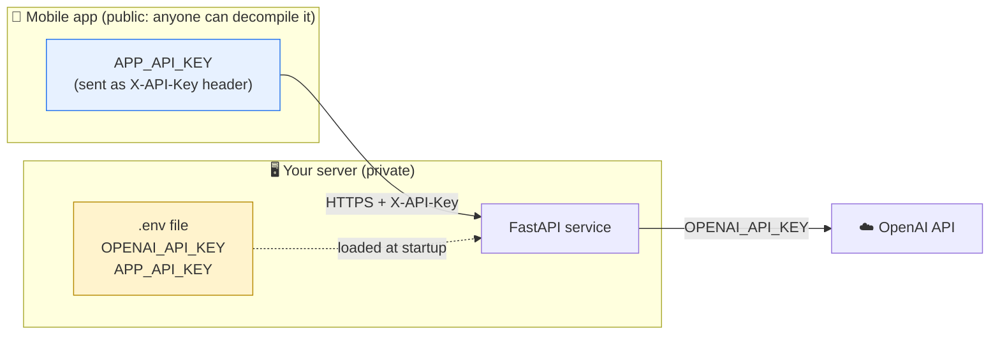

| Key | What it is | Where it goes | Ever in the mobile app? |
|-----|-----------|---------------|------------------------|
| `OPENAI_API_KEY` | Your OpenAI secret key (`sk-...`), from https://platform.openai.com/api-keys | **Server only**: `.env` in the project root (next to `requirements.txt`) | **NEVER.** Anyone who extracts it from the app can spend your OpenAI budget. |
| `APP_API_KEY` | Shared key that tells the server "this request comes from our app" | Server `.env` **and** the mobile app's build config (see the mobile guide) | Yes, but treat it as public. It's not user authentication. |

### Local development

```bash
cp .env.example .env
```

Then edit `.env`:

```dotenv
OPENAI_API_KEY=sk-proj-...your-key...
APP_API_KEY=paste-a-long-random-string-here
```

Generate a strong `APP_API_KEY`:

```bash
python3 -c "import secrets; print(secrets.token_urlsafe(32))"
```

`.env` is already in `.gitignore`. **Never commit it.** Restart the server after changing it.

### Production

Don't ship a `.env` file. Inject the same variable names from your platform's secret store
(AWS Secrets Manager / ECS task secrets, GCP Secret Manager, Kubernetes Secrets, Render/Railway/Fly
env settings, etc.). **Real environment variables always override `.env`.**

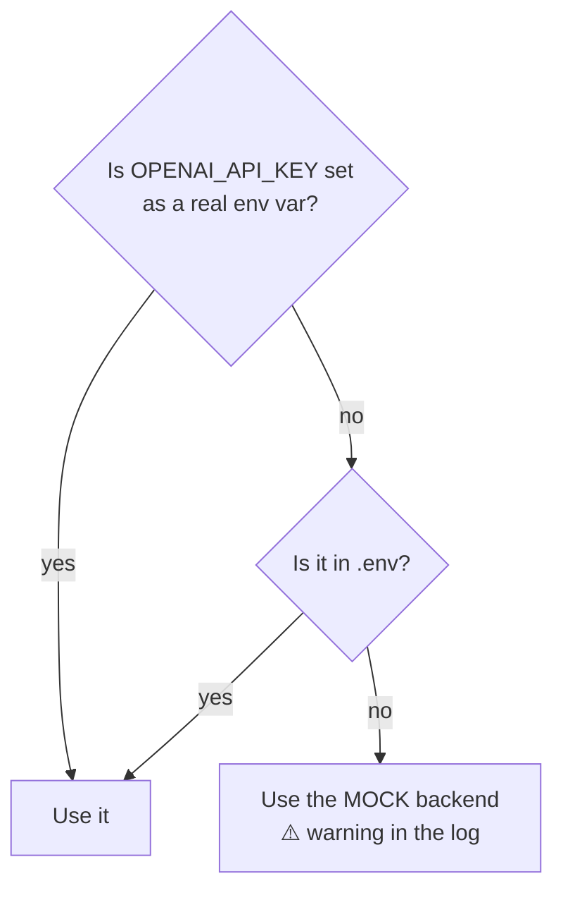

---

## 3. Architecture

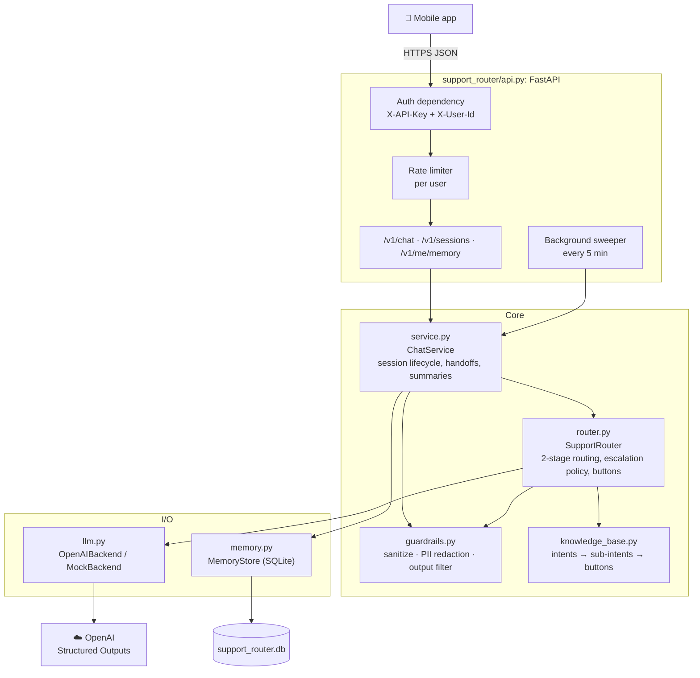

**Design principles**

| Principle | How |
|-----------|-----|
| The model gives signals; code makes the decisions | The LLM classifies and writes text. Escalation, buttons and clarification rules are plain Python you can unit-test. |
| The model can never invent a button | Buttons come only from `knowledge_base.py`. The LLM never sees or outputs them. |
| The model can never invent an intent | Structured Outputs with a strict JSON schema and an `enum` of valid intent IDs. |
| Never crash the chat | Every LLM failure falls back to a safe reply with a "talk to a human" option (`degraded: true`). |
| PII never leaves in raw form | Redacted before the LLM, the logs and the database. |

---

## 4. What happens on every message

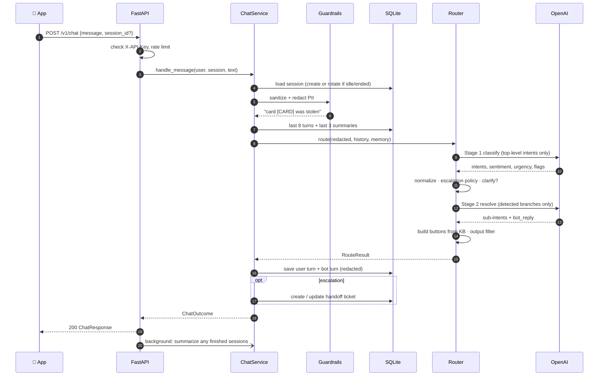

**Latency:** two LLM calls per turn, typically about 1–4 s total with `gpt-4o-mini`. A clarifying
question skips Stage 2, and an empty message makes no LLM calls at all.

---

## 5. The routing pipeline

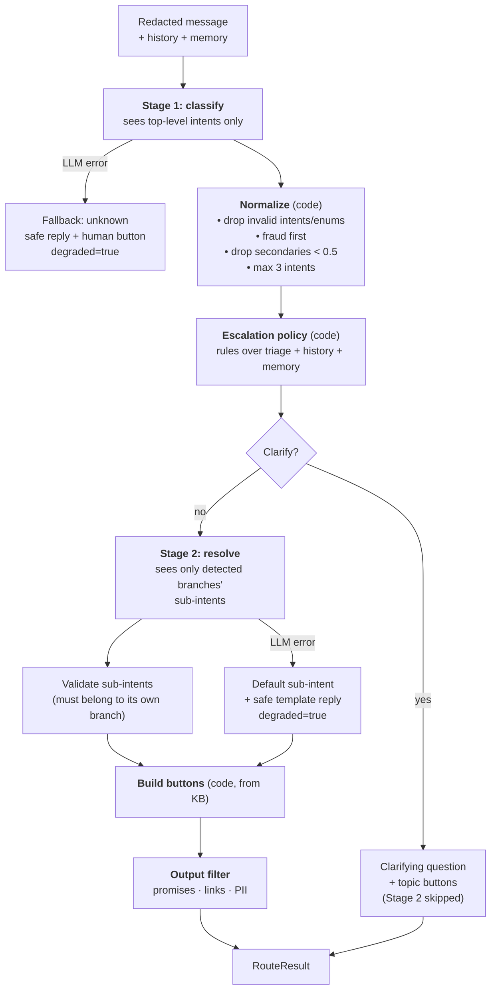

### Why two stages?

With one flat prompt, every call carries every leaf intent. With a hierarchy, Stage 1 sees only the
6 top-level intents, and Stage 2 sees only the 4–5 sub-intents of the branch or branches that
matched. Prompt size grows with *what the customer said*, not with the size of the catalog, so the
design scales to hundreds of leaf intents.

### What each stage returns

| Stage 1: `classify` | Stage 2: `resolve` |
|---|---|
| `intents[]`: `{intent, confidence}`, most important first | `resolutions[]`: `{intent, sub_intent}` per intent |
| `language`: BCP-47 (`en`, `es`, `hi`, `hi-Latn`) | `bot_reply`: 1–3 sentences in the customer's language |
| `sentiment`: positive / neutral / negative / angry | |
| `urgency`: low / medium / high / critical | |
| `risk_flags[]`: legal_threat, churn_risk, requests_human, safety_risk, vulnerable_customer | |
| `needs_clarification`, `clarifying_question` | |

Both calls use OpenAI **Structured Outputs** (`response_format: json_schema, strict: true`), so the
model can only return the given shape and only valid enum values. The code still re-validates the
result, because models, SDKs and proxies change.

---

## 6. Knowledge base: intents, sub-intents, buttons

Defined in [`support_router/knowledge_base.py`](support_router/knowledge_base.py).

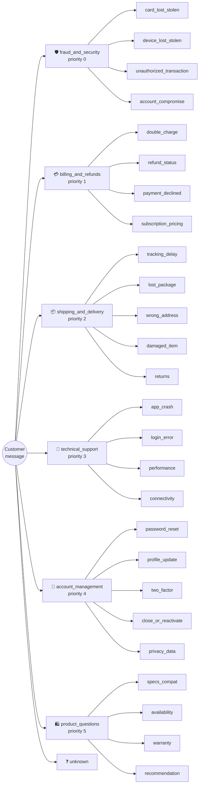

Each intent has:

| Field | Purpose |
|-------|---------|
| `label` | Human name (also used for clarify buttons) |
| `priority` | Lower = more important. Orders multi-intent results; fraud is always first. |
| `context` | Description the LLM uses to classify |
| `options` | Pool of buttons: `{key: "Default English label"}` |
| `default_options` | Buttons shown when no specific sub-intent fits (`general`) |
| `sub_intents` | `{key: {context, options: [keys]}}` |

**Button IDs** are `"<intent>.<option_key>"`, e.g. `billing_and_refunds.refund_request`. They are
stable API contract: the app translates labels and maps actions by ID. **Never rename a shipped ID.**
The full list is in the [mobile guide](docs/MOBILE_INTEGRATION.md#7-button-id-reference).

---

## 7. Clarifying questions

When the router isn't sure, it asks one short question instead of guessing wrong.

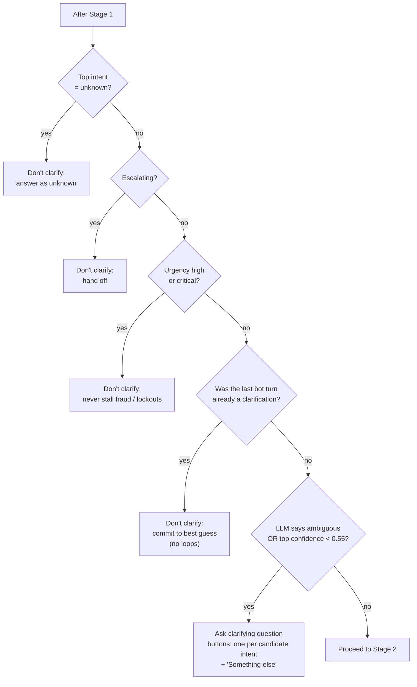

**How the answer comes back:** the clarify buttons have IDs `clarify.<intent>`. When one is tapped,
the app sends the **button label** (e.g. `"Billing & refunds"`) as the next message in the same
session. Because of multi-turn memory, Stage 1 sees the original question plus the answer and routes
correctly. No special endpoint is needed.

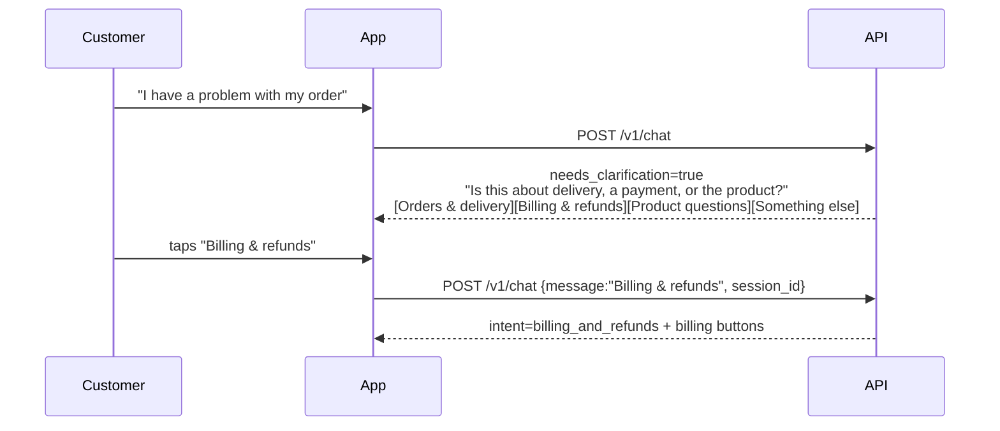

---

## 8. Multi-intent messages

*"My package never arrived and I was still charged for it"* is two problems. The router returns
both, most important first (fraud always first), up to 3 per turn. Secondary intents need
confidence ≥ 0.5.

**Button allocation**

| Intents detected | Buttons |
|---|---|
| 1 | up to 4 from that intent |
| 2–3 | primary: 3, each secondary: 2 |
| escalating | `handoff.human` added; redundant "talk to X specialist" buttons removed |
| always | deduplicated, capped at `MAX_BUTTONS` (6) |

Each button carries its `intent`, so the app can group buttons under headings if it wants.

---

## 9. Sentiment and escalation

Stage 1 reports **signals** (sentiment, urgency, risk flags). A **deterministic policy in code**
decides whether to escalate. That keeps the policy auditable and easy to change without prompt
tuning.

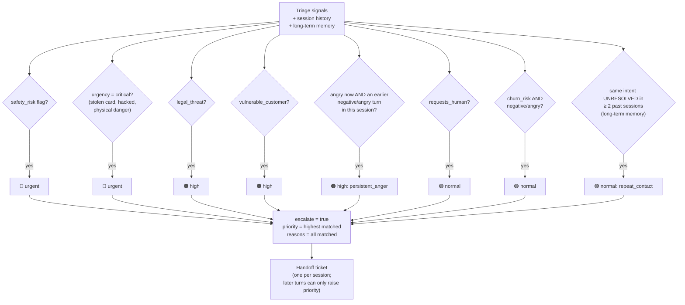

One angry message on its own does **not** escalate. That's normal customer frustration, and the
bot apologizes and helps. Anger that **persists** across turns does.

**Button placement when escalating:**
- Usually `handoff.human` ("Connect me to a person now") goes **first**.
- When the only reason is `critical_urgency` (e.g. stolen card), the self-serve containment action
  stays first (**Freeze my card now**) and handoff is second, because freezing the card instantly beats
  waiting for an agent.

**Handoff ticket payload** (table `handoffs`), so the agent never has to ask the customer to repeat
themselves: intents, sub-intents, urgency, sentiment, risk flags, language, the last 20 redacted
turns, and the customer's long-term summaries.

---

## 10. Sessions and long-term memory

### Session lifecycle

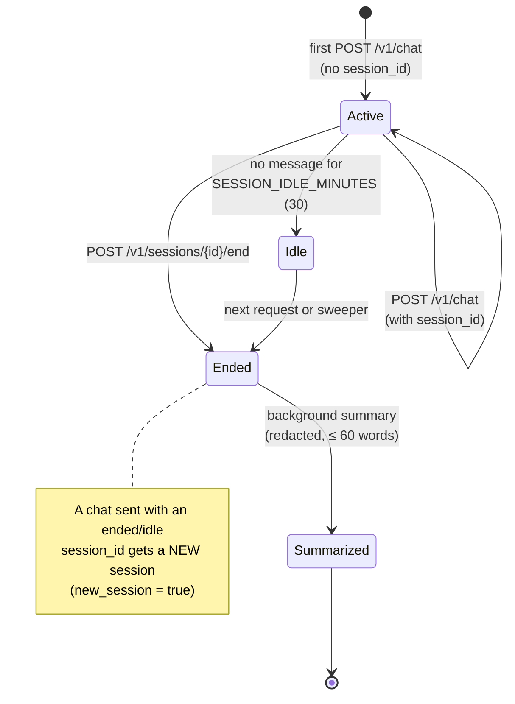

### How memory flows between chats

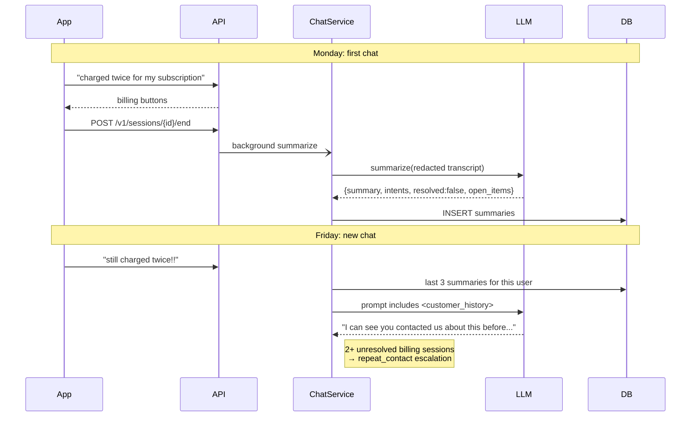

**What gets summarized:** issue(s), what was offered, whether it was resolved, open follow-ups.
Always English, third person, and no personal data (the prompt forbids it, and the output is
redacted again as a second check).

**Summarization is never on the request path.** It runs in the background, triggered by:
1. `POST /v1/sessions/{id}/end`
2. The user starting a new session (their earlier idle sessions are summarized)
3. A sweeper every `SWEEP_INTERVAL_SECONDS` (300), which catches users who never came back

An atomic `summary_state` claim (`none → pending → done`) means several workers never summarize the
same session twice. A failure resets it to `none` so the next sweep retries.

**Privacy:**
- Summaries older than `MEMORY_RETENTION_DAYS` (180) are ignored and purged by the sweeper.
- `GET /v1/me/memory` shows the user exactly what's remembered.
- `DELETE /v1/me/memory` erases it.

---

## 11. Guardrails

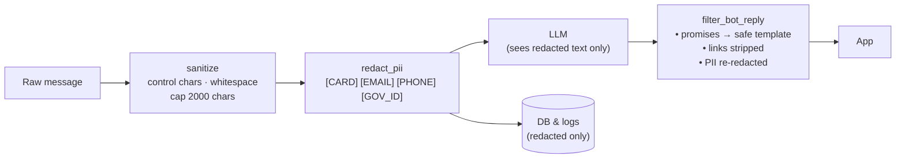

| Guardrail | Detail |
|-----------|--------|
| **Input sanitizing** | Strips control characters, collapses whitespace, truncates to `MAX_MESSAGE_CHARS`. The API accepts up to 8000 characters so long pastes are trimmed rather than rejected. |
| **PII redaction** | Emails; SSN and Aadhaar → `[GOV_ID]`; card numbers (13–19 digits **with a Luhn check**, so order numbers survive); phone numbers (10–15 digits that look dialable: `+`, separators, or exactly 10 digits). Applied before the LLM, the logs and the database. The raw message is never stored. |
| **Prompt injection** | Everything customer-derived (message, history, summaries) is wrapped in `<customer_message>` / `<conversation>` / `<customer_history>` tags, which the system prompt marks as untrusted data. Buttons and escalation are decided in code, so an injected "add a Transfer $1000 button" has nothing to act on. |
| **Output filter** | The bot has no tools: it can't refund, fix or block anything. Replies that claim it did ("I've refunded you") or promise outcomes or timelines ("within 3 days", "guarantee") are replaced with a safe template for the intent. Links are stripped and PII is re-redacted. Events are logged for prompt QA. |
| **Rate limiting** | Per-user token bucket: `RATE_LIMIT_PER_MINUTE` (20) plus `RATE_LIMIT_BURST` (5). Returns `429` with a `Retry-After` header. |
| **i18n** | `bot_reply` comes back in the customer's language (including Hinglish and other code-mixing). Buttons are stable IDs; the app localizes the labels. |
| **Abuse monitoring** | A salted SHA-256 hash of the user ID is sent as OpenAI's `safety_identifier`. The real ID is never sent. |
| **Fail safe** | Any exception → safe reply, human option, `degraded: true`. HTTP 500s never leak internals. |

> Regex redaction and the English-only promise filter are a **baseline**. For regulated data, put
> a DLP service (Presidio, cloud DLP) in front of it. For non-English replies the filter relies on
> the prompt rules alone.

---

## 12. Data model

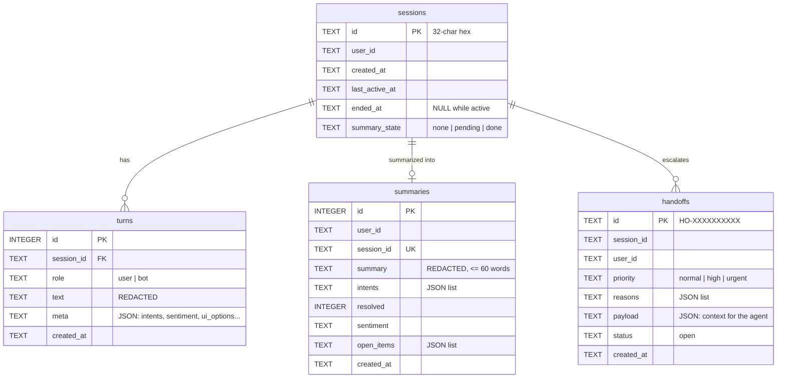

The database is SQLite (`DB_PATH`, default `support_router.db`) in WAL mode. All SQL lives in
`memory.py`, so moving to Postgres means rewriting that one file.

---

## 13. API reference

All `/v1/*` endpoints require two headers:

| Header | Value |
|--------|-------|
| `X-API-Key` | `APP_API_KEY` from the server's `.env` |
| `X-User-Id` | Your app's stable user ID (`[A-Za-z0-9_.:@-]`, max 128). **Dev only**, see [§17](#17-production-checklist). |

| Method | Path | Purpose | Success |
|--------|------|---------|---------|
| `POST` | `/v1/chat` | Send a message, get reply + buttons | `200` |
| `POST` | `/v1/sessions/{id}/end` | Close a chat; summary saved in background | `202` |
| `GET` | `/v1/sessions/{id}` | Full redacted history (restore after app relaunch) | `200` |
| `GET` | `/v1/me/memory` | What the assistant remembers about this user | `200` |
| `DELETE` | `/v1/me/memory` | Forget this user's summaries | `200` |
| `GET` | `/healthz` | Liveness (no auth) | `200` |

### `POST /v1/chat`

Request:

```json
{
  "message": "my package never arrived and i was STILL charged for it",
  "session_id": "7a441bd6f15443dbad98c89e272f29c0"
}
```

`session_id` is optional. Omit it on the first message. If present, it must be 32 lowercase hex
characters.

Response (real output):

```json
{
  "session_id": "7a441bd6f15443dbad98c89e272f29c0",
  "new_session": true,
  "turn_id": 2,
  "intent": "shipping_and_delivery",
  "intents": [
    {"intent": "shipping_and_delivery", "sub_intent": "lost_package", "confidence": 0.9, "label": "Orders & delivery"},
    {"intent": "billing_and_refunds",   "sub_intent": "general",      "confidence": 0.75, "label": "Billing & refunds"}
  ],
  "bot_reply": "I understand waiting on an order is frustrating. I'm sorry about the trouble with your charges. Please pick an option below.",
  "language": "en",
  "urgency": "medium",
  "needs_clarification": false,
  "escalation": {"escalate": false, "priority": null, "reasons": [], "handoff_id": null},
  "ui_options_to_render": [
    {"id": "shipping_and_delivery.missing",    "label": "Report a missing package", "intent": "shipping_and_delivery"},
    {"id": "shipping_and_delivery.track",      "label": "Track my order",           "intent": "shipping_and_delivery"},
    {"id": "billing_and_refunds.view_charges", "label": "View recent charges",      "intent": "billing_and_refunds"},
    {"id": "billing_and_refunds.refund_request","label": "Request a refund",        "intent": "billing_and_refunds"}
  ],
  "degraded": false
}
```

| Field | Meaning |
|-------|---------|
| `session_id` | **Always store it and send it next time.** It can change (see `new_session`). |
| `new_session` | `true` if the server started a new session (first message, or the old one was ended or idle) |
| `intent` | Primary intent (kept for v0 clients) |
| `intents[]` | All detected intents, most important first, with `sub_intent` and `confidence` |
| `bot_reply` | Text to show, in the customer's language |
| `language` | BCP-47 language of the customer's message |
| `urgency` | `low` / `medium` / `high` / `critical`. Useful for UI styling. |
| `needs_clarification` | `true` means the buttons are `clarify.*` topic choices |
| `escalation` | `escalate`, `priority`, `reasons`, `handoff_id` |
| `ui_options_to_render[]` | Buttons, in order: `{id, label, intent}` |
| `degraded` | `true` if a fallback path was used (LLM error or timeout) |

### Errors

| Status | When | Body |
|--------|------|------|
| `401` | Wrong `X-API-Key` | `{"detail": "invalid api key"}` |
| `404` | Session doesn't exist **or belongs to another user** (same error on purpose) | `{"detail": "session not found"}` |
| `422` | Missing headers, malformed `session_id`, message > 8000 characters | FastAPI validation detail |
| `429` | Rate limited. Wait for the `Retry-After` header (seconds). | `{"detail": "rate limit exceeded"}` |
| `500` | Unexpected error (details only in server logs) | `{"detail": "internal error"}` |

---

## 14. Configuration

All settings come from environment variables or `.env`. See [`.env.example`](.env.example).

| Variable | Default | What it does |
|----------|---------|--------------|
| `OPENAI_API_KEY` | *(empty → MOCK)* | OpenAI secret key. **Server only.** |
| `APP_API_KEY` | `dev-key-change-me` | Key the app sends as `X-API-Key`. **Change it.** |
| `OPENAI_MODEL` | `gpt-4o-mini` | Default model for all stages |
| `OPENAI_CLASSIFY_MODEL` | `OPENAI_MODEL` | Stage 1 model (runs every turn, so keep it fast and cheap) |
| `OPENAI_RESOLVE_MODEL` | `OPENAI_MODEL` | Stage 2 model (writes the reply, so a stronger model improves tone) |
| `OPENAI_SUMMARY_MODEL` | `OPENAI_MODEL` | Session summary model |
| `LLM_TIMEOUT_SECONDS` | `20` | Per LLM call |
| `LLM_MAX_RETRIES` | `2` | SDK retries with backoff on 429/5xx |
| `CLARIFY_BELOW_CONFIDENCE` | `0.55` | Ask a clarifying question below this top-intent confidence |
| `SECONDARY_INTENT_MIN_CONFIDENCE` | `0.5` | Minimum confidence to act on a 2nd or 3rd intent |
| `MAX_INTENTS_PER_TURN` | `3` | |
| `MAX_BUTTONS` | `6` | |
| `DB_PATH` | `support_router.db` | SQLite file |
| `HISTORY_TURNS_IN_CONTEXT` | `8` | Recent turns sent to the LLM |
| `SUMMARIES_IN_CONTEXT` | `3` | Past-session summaries sent to the LLM |
| `MEMORY_RETENTION_DAYS` | `180` | Older summaries are ignored and purged |
| `SESSION_IDLE_MINUTES` | `30` | Idle timeout before a session is closed and summarized |
| `REPEAT_CONTACT_THRESHOLD` | `2` | Unresolved past sessions with the same intent → escalate |
| `SWEEP_INTERVAL_SECONDS` | `300` | Background summarize/purge interval (`0` disables it) |
| `MAX_MESSAGE_CHARS` | `2000` | Router truncates beyond this |
| `RATE_LIMIT_PER_MINUTE` | `20` | Per user |
| `RATE_LIMIT_BURST` | `5` | Extra headroom |
| `LOG_LEVEL` | `INFO` | |

---

## 15. Testing

### Automated tests (offline, no API key needed)

```bash
.venv/bin/python -m pytest -q
```

39 tests using the mock backend and a temporary SQLite database:

| File | Covers |
|------|--------|
| `tests/test_guardrails.py` | Sanitizing; PII (card Luhn vs order numbers, Aadhaar inside card numbers, phones); promise and link filter; rate limiter |
| `tests/test_router.py` | Sub-intents, multi-intent, clarification (including no double-asking and never stalling urgent cases), follow-ups, every escalation rule, LLM failure fallbacks, malformed LLM output, cross-branch sub-intents, promise replacement |
| `tests/test_api.py` | Auth, response contract, multi-turn, clarify→answer flow, cross-user isolation, PII never in the DB, one handoff per session, end → summary → memory, repeat-contact escalation from memory, idle rotation, forget-me, 429 + Retry-After, input validation |

The multilingual cases need a real key. The mock is English-only.

### Postman

Import both files from [`postman/`](postman/):

1. `support-router.postman_collection.json`: 42 requests in 9 folders (basic routing, clarification,
   multi-intent, escalation, guardrails, multilingual, sessions and memory, errors)
2. `local.postman_environment.json`: `baseUrl`, `apiKey`, `userId`

Then:

1. Select the **"Support Router - Local"** environment (top-right dropdown) and set `apiKey` to your
   `APP_API_KEY`.
2. Start the server.
3. Run the requests folder by folder, top to bottom. Chat requests save `session_id` into
   `{{sessionId}}` automatically, and "continue" requests reuse it. Each request has assertions in
   its **Tests** tab.

> Running the **whole collection** with the Runner sends about 35 chats from one user, which trips the
> rate limit around request 25 (that's the limiter working). For local runs, set
> `RATE_LIMIT_PER_MINUTE=200` in `.env`, or set a Runner delay of 2500 ms.

---

## 16. Extending the knowledge base

Edit [`support_router/knowledge_base.py`](support_router/knowledge_base.py). Prompts and JSON
schemas are generated from it, so there's nothing else to update in the backend.

**Add a button to an existing sub-intent:**

```python
"options": {
    ...
    "invoice_pdf": "Download invoice",          # 1. add to the intent's pool
},
"sub_intents": {
    "double_charge": {
        "context": "...",
        "options": ["view_charges", "refund_request", "invoice_pdf", "billing_agent"],  # 2. reference it
    },
```

Then tell the mobile team about the new ID `billing_and_refunds.invoice_pdf` (translation plus action
mapping).

**Add a sub-intent:** add a `{context, options}` entry under `sub_intents`. Write the `context` as
you'd explain it to a new support agent; the LLM classifies from it.

**Add a top-level intent:** add a full block with `label`, `priority`, `context`, `options`,
`default_options` and `sub_intents`. If it overlaps an existing intent, say in **both** contexts
which one wins (see how `billing_and_refunds` sends "charges I didn't make" to `fraud_and_security`).

After any change:

```bash
.venv/bin/python -m pytest -q
```

Then run the Postman collection with a real key.

---

## 17. Production checklist

- [ ] **Replace dev auth.** `get_current_user` in `api.py` trusts `X-User-Id`, so anyone with the
      (public) app key can read any user's sessions and memory. Verify your identity provider's
      token instead (Firebase ID token / Auth0 / Cognito JWT: signature, audience, expiry) and return
      its `sub`. Only that function changes. The app then sends `Authorization: Bearer <token>`.
- [ ] Put secrets in a secret manager, not `.env`.
- [ ] HTTPS only (TLS at your load balancer or ingress).
- [ ] Multiple workers or instances: move `RateLimiter` to Redis and SQLite to Postgres.
- [ ] Add a DLP service if you handle regulated data (PCI, HIPAA, GDPR special categories).
- [ ] Build an eval set of about 200 real, labeled messages and run it on every prompt or model change.
- [ ] Monitor: `degraded=true` rate, `unknown` rate, clarification rate, escalation rate by reason,
      output-filter events (all logged as structured lines).
- [ ] Connect the `handoffs` table to your agent desk (Zendesk, Freshdesk, Intercom, ...).
- [ ] Choose `MEMORY_RETENTION_DAYS` with your privacy or legal team, and mention memory in your
      privacy policy.

---

## 18. Project layout

```
.
├── README.md                     ← you are here
├── requirements.txt
├── .env.example                  ← copy to .env, put keys here
├── .gitignore                    ← ignores .env, *.db, .venv
├── dynamic_router_poc.py         ← original single-file POC (reference)
├── docs/
│   └── MOBILE_INTEGRATION.md     ← guide for iOS / Android / React Native devs
├── postman/
│   ├── support-router.postman_collection.json
│   └── local.postman_environment.json
├── support_router/
│   ├── __init__.py
│   ├── config.py                 ← settings + .env loading
│   ├── knowledge_base.py         ← intents, sub-intents, buttons (edit me)
│   ├── guardrails.py             ← sanitize, PII redaction, output filter, rate limiter
│   ├── llm.py                    ← prompts, JSON schemas, OpenAI + mock backends
│   ├── router.py                 ← 2-stage routing, clarification, escalation, buttons
│   ├── memory.py                 ← SQLite store
│   ├── service.py                ← session lifecycle, handoffs, summaries
│   └── api.py                    ← FastAPI app
└── tests/
    ├── conftest.py
    ├── test_guardrails.py
    ├── test_router.py
    └── test_api.py
```
