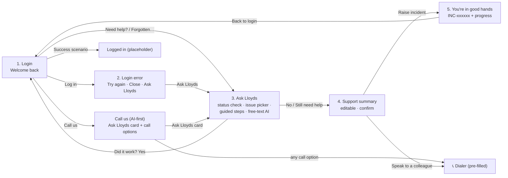

# Lloyds Support: Android prototype

A Jetpack Compose prototype of the **AI-first "Call us" page** and the **unauthenticated login-support
journey with Ask Lloyds**, built from the design mockups. It talks to the Support Router API in the
parent folder.

> **Prototype, not a Lloyds product.** The logo is a placeholder, and all phone numbers, error codes
> and guidance copy are demo content (see [Replace before use](#replace-before-use)).

## Screens



| Mockup | Screen | Source file |
|--------|--------|-------------|
| Call us, proposed (image 1) | `CallUsScreen` | `ui/screens/CallUsScreen.kt` |
| Step 1: Login attempt | `LoginScreen` | `ui/screens/LoginScreens.kt` |
| Step 2: Login error with AI option | `LoginErrorScreen` | `ui/screens/LoginScreens.kt` |
| Steps 2–5: known issues, context, suggested step, did it work | `AskLloydsScreen` | `ui/screens/AskLloydsScreen.kt` + `AskLloydsController.kt` |
| Step 6: Review and raise an incident | Summary card in `AskLloydsScreen` | same |
| Step 7: You're in good hands | `IncidentScreen` | `ui/screens/IncidentScreen.kt` |

## Where the data comes from

| Piece | Source |
|-------|--------|
| "No known outages" / "Known issue" card | `GET /v1/service-status`: mock ServiceNow on the backend, which you can toggle (see below) |
| Issue choices + suggested next steps | **Hard-coded** in `journey/Journey.kt` (`Guidance`) |
| Typed questions ("Type your question…") | `POST /v1/chat`: the LLM Support Router. Reply + buttons, clarifying questions, escalation. |
| Additional context (auto-detected) | The device: app version, model, network type/carrier, login attempts |
| Raise incident | `POST /v1/incidents`: mock ServiceNow; returns `INC-100001`, `INC-100002`, … |
| Track progress | `GET /v1/incidents/{ref}`: mock lifecycle, *received* → *under investigation* after 2 minutes |

The login journey is **unauthenticated**: the app sends an anonymous per-install ID as `X-User-Id`.
The User ID typed on the login screen is sent only as an **unverified** `customer_reference` inside the
incident, labelled "User ID (not verified)" in the summary.

Each Ask Lloyds conversation starts a **new** chat session. The previous one is ended, so the server
summarizes it into long-term memory.

## Tech

- Kotlin + **Jetpack Compose (Material3)**, compileSdk 36, minSdk 24
- Networking: **plain `HttpURLConnection` + `org.json`** (no Retrofit, OkHttp or Moshi)
- No navigation, ViewModel or DI libraries. Navigation is a small back stack in `MainActivity.kt`.
- Dependencies: Compose BOM, `activity-compose`, `material-icons-core`. That's all.

```
app/src/main/java/com/example/supportrouter/
├── MainActivity.kt              ← Compose entry + back-stack navigation + dialer
├── SupportApi.kt                ← HttpURLConnection client (chat, sessions, status, incidents)
├── Models.kt                    ← data classes + org.json parsing
├── AppConfig.kt                 ← server URL, app key, anonymous user ID, session ID
├── journey/
│   ├── Journey.kt               ← ⚠️ scenarios, guidance copy, phone numbers (placeholders)
│   └── DeviceContext.kt         ← auto-detected context
└── ui/
    ├── theme/Theme.kt           ← colors + typography
    ├── Components.kt            ← BrandLogo (placeholder), buttons, cards, tags
    └── screens/                 ← Login, LoginError, CallUs, AskLloyds, Incident
```

## Run it

### 1. Backend (project root, one folder up)

```bash
cd ..
python3 -m venv .venv && .venv/bin/pip install -r requirements.txt
cp .env.example .env            # set OPENAI_API_KEY, APP_API_KEY, ADMIN_API_KEY
.venv/bin/uvicorn support_router.api:app --host 0.0.0.0 --port 8000
```

### 2. App config: `android/local.properties` (git-ignored)

```properties
sdk.dir=/Users/<you>/Library/Android/sdk
SUPPORT_API_URL=http://localhost:8000     # USB phone via adb reverse (below); emulator: http://10.0.2.2:8000
SUPPORT_APP_KEY=<same value as APP_API_KEY in the server .env>
```

Never put `OPENAI_API_KEY` in the app.

### 3. Install

Phone on USB: `adb reverse` makes the phone's `localhost:8000` reach your Mac, so no Wi-Fi IP is needed.

```bash
adb reverse tcp:8000 tcp:8000
```

```bash
./gradlew installDebug
```

Or use Android Studio: **File → Open → `android/` → Run ▶**. Gradle needs JDK 17+; Android Studio's
bundled JDK works.

Debug builds have **Demo controls** at the bottom of the Login screen:
- **Log in result:** Technical error / OTP not received / Account locked / Success
- **Server settings:** change the URL and app key without rebuilding

## Demo script

1. **Login → Log in** (Technical error) → error screen → **Ask Lloyds**
2. Status card → pick **"I haven't received my security code (OTP)"** → suggested step → **I've tried this**
3. **Did it work? → No** → support summary (tap **Edit** to change values, **Add a message**) → tick confirm
   → **Raise incident**
4. **You're in good hands**, `INC-100001` → wait 2 min → **View my support status** → *Under investigation*
5. **Back to login → Call us** → **Ask Lloyds** card → type *"i got charged twice"* → AI reply and buttons

**Show the "known issue" path:**

```bash
curl -X PUT localhost:8000/v1/admin/service-status -H "X-Admin-Key: <ADMIN_API_KEY>" \
  -H "Content-Type: application/json" -d '{"status":"known_issue"}'
```

Open Ask Lloyds again and an amber *Known issue* card appears. Reset it with `{"status":"operational"}`.

## Replace before use

| What | Where |
|------|-------|
| Brand logo | `BrandLogo()` in `ui/Components.kt`: swap the dashed "LOGO" box for the approved asset |
| Phone numbers (all placeholders `0000000000x`) | `ContactNumbers` in `journey/Journey.kt` |
| Error titles, codes (`TE-1001`, `OTP-2001`, `LCK-3001`) | `LoginScenario` in `journey/Journey.kt` |
| Issue list, guidance steps, "why" text, suggested causes | `Guidance` in `journey/Journey.kt` |
| Mock ServiceNow | `support_router/integrations.py` on the backend |
| `X-User-Id` / app key auth | `docs/MOBILE_INTEGRATION.md` §14 |

## Troubleshooting

| Symptom | Fix |
|---------|-----|
| "Couldn't check service status" / "can't reach Ask Lloyds" | Server not running with `--host 0.0.0.0`; `adb reverse` missing (it's reset when you unplug); wrong URL in Demo controls → Server settings |
| "invalid app key" | `SUPPORT_APP_KEY` / Server settings key must equal `APP_API_KEY` in the server `.env` |
| Generic English-only AI replies | Server is running without `OPENAI_API_KEY` (MOCK backend) |
| Dialer doesn't open | No phone app on the device (e.g. a tablet); a toast shows the number |
