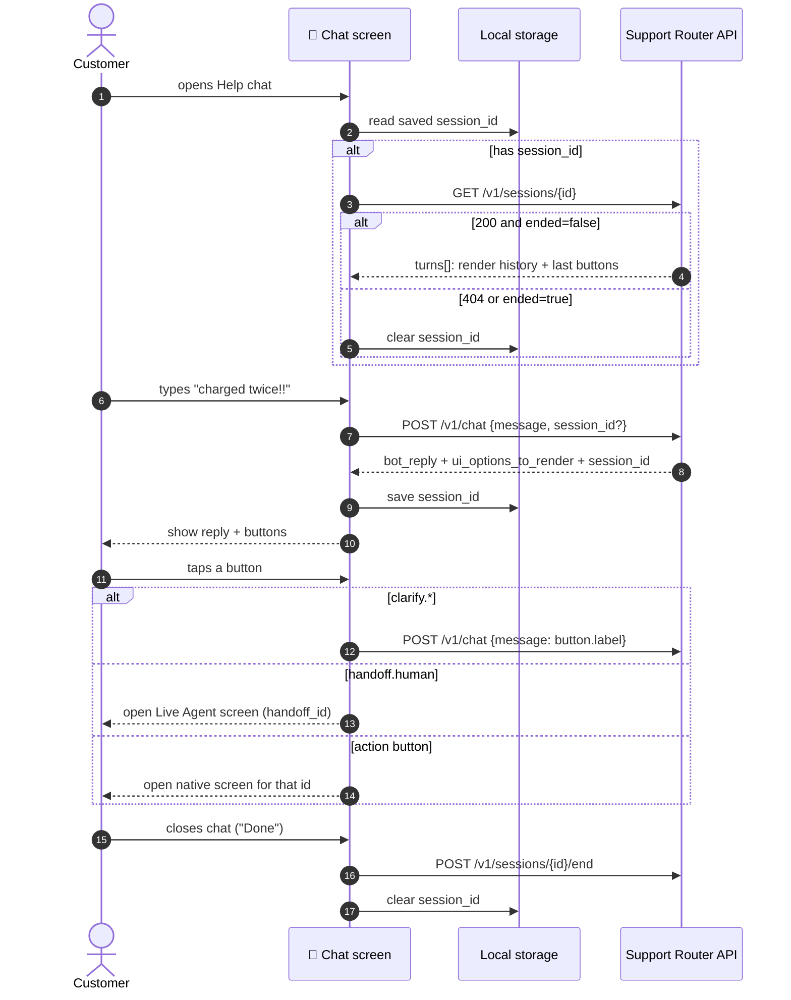
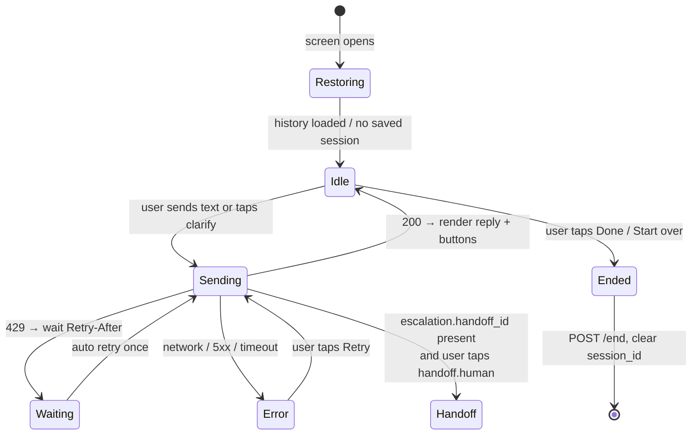
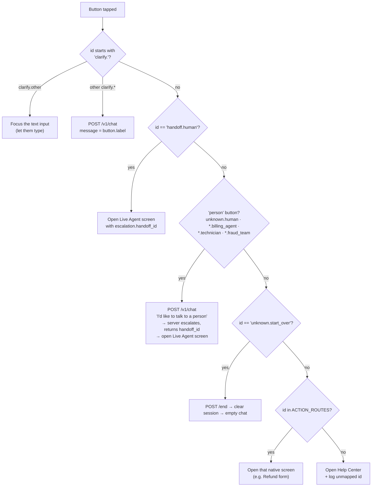
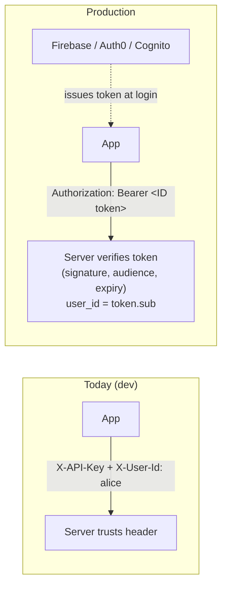

# Mobile Integration Guide

How to connect an iOS, Android or React Native app to the Support Router API.
It covers setup, the API contract, UI behavior, button handling, errors, and ready-to-adapt
client code for **Swift**, **Kotlin** and **TypeScript (React Native)**.

> Backend setup and architecture: see the [README](../README.md).
> Try every request first in Postman: [`postman/`](../postman/).

**Contents**

1. [Golden rules](#1-golden-rules)
2. [How the app talks to the service](#2-how-the-app-talks-to-the-service)
3. [Configure the app (URL + key)](#3-configure-the-app-url--key)
4. [Reaching your dev server from a simulator or phone](#4-reaching-your-dev-server-from-a-simulator-or-phone)
5. [API contract](#5-api-contract)
6. [Chat screen behavior](#6-chat-screen-behavior)
7. [Button ID reference](#7-button-id-reference)
8. [Errors, timeouts and retries](#8-errors-timeouts-and-retries)
9. [Localization](#9-localization)
10. [Privacy screen (memory)](#10-privacy-screen-memory)
11. [Client code: TypeScript / React Native](#11-client-code-typescript--react-native)
12. [Client code: Swift / iOS](#12-client-code-swift--ios)
13. [Client code: Kotlin / Android](#13-client-code-kotlin--android)
14. [Moving to production auth](#14-moving-to-production-auth)
15. [QA checklist](#15-qa-checklist)

---

## 1. Golden rules

1. **Never put `OPENAI_API_KEY` in the app.** The app talks only to *our* server. The server
   talks to OpenAI. An app binary can be decompiled, so anything inside it is public.
2. **`APP_API_KEY` is not a secret.** It identifies the app, not the user. Keep it out of source
   control anyway (build config, not code) so it can be rotated per environment.
3. **Always adopt the `session_id` from every response.** The server may start a new session.
4. **Buttons are identified by `id`, never by `label`.** Labels are English defaults and may change.
5. **Render what the server sends.** Don't hardcode flows per intent. The server decides the buttons.
6. **Don't show internal fields** (`confidence`, `reasons`, `sub_intent`) to customers. They're
   for analytics and debugging.

---

## 2. How the app talks to the service



---

## 3. Configure the app (URL + key)

Two values go into the app's build configuration, one per environment:

| Name | Dev example | Prod example |
|------|-------------|--------------|
| `SUPPORT_API_URL` | `http://10.0.2.2:8000` (Android emulator) / `http://localhost:8000` (iOS simulator) | `https://support-api.yourcompany.com` |
| `SUPPORT_APP_KEY` | the `APP_API_KEY` from the server's `.env` | the production `APP_API_KEY` |

The value of `SUPPORT_APP_KEY` must match `APP_API_KEY` in the server's `.env` **exactly**, or every
request gets `401`.

### React Native

Use [`react-native-config`](https://github.com/lugg/react-native-config). Create `.env` in the **app**
repo (git-ignored):

```dotenv
SUPPORT_API_URL=http://localhost:8000
SUPPORT_APP_KEY=dev-key-change-me
```

Read it in code:

```ts
import Config from 'react-native-config';

Config.SUPPORT_API_URL;
Config.SUPPORT_APP_KEY;
```

For Expo, use `EXPO_PUBLIC_SUPPORT_API_URL` / `EXPO_PUBLIC_SUPPORT_APP_KEY` in `.env` and read them
with `process.env.EXPO_PUBLIC_...`.

### iOS (Xcode)

1. Create `Config/Debug.xcconfig` (git-ignored) and a matching `Release.xcconfig`:
   ```
   // xcconfig treats "//" as a comment, so split the URL with $()
   SUPPORT_API_URL = http:/$()/localhost:8000
   SUPPORT_APP_KEY = dev-key-change-me
   ```
2. In **Project → Info → Configurations**, set Debug/Release to those files.
3. In `Info.plist`, add:
   ```xml
   <key>SupportApiUrl</key><string>$(SUPPORT_API_URL)</string>
   <key>SupportAppKey</key><string>$(SUPPORT_APP_KEY)</string>
   ```
4. Read the values in code:
   ```swift
   Bundle.main.object(forInfoDictionaryKey: "SupportApiUrl") as! String
   ```

### Android (Gradle)

1. Add to `local.properties` (already git-ignored by Android Studio):
   ```properties
   SUPPORT_API_URL=http://10.0.2.2:8000/
   SUPPORT_APP_KEY=dev-key-change-me
   ```
2. In `app/build.gradle.kts`:
   ```kotlin
   import java.util.Properties

   val localProps = Properties().apply {
       rootProject.file("local.properties").takeIf { it.exists() }?.inputStream()?.use { load(it) }
   }

   android {
       buildFeatures { buildConfig = true }
       defaultConfig {
           buildConfigField("String", "SUPPORT_API_URL", "\"${localProps["SUPPORT_API_URL"] ?: ""}\"")
           buildConfigField("String", "SUPPORT_APP_KEY", "\"${localProps["SUPPORT_APP_KEY"] ?: ""}\"")
       }
   }
   ```
3. Use `BuildConfig.SUPPORT_API_URL` and `BuildConfig.SUPPORT_APP_KEY`. On CI, inject them from
   CI secrets.

---

## 4. Reaching your dev server from a simulator or phone

Start the server bound to all interfaces:

```bash
.venv/bin/uvicorn support_router.api:app --host 0.0.0.0 --port 8000
```

| Where the app runs | Base URL |
|--------------------|----------|
| iOS Simulator | `http://localhost:8000` |
| Android Emulator | `http://10.0.2.2:8000` (`10.0.2.2` = your computer) |
| Physical phone on the same Wi-Fi | `http://<your-computer-LAN-IP>:8000`. On macOS, get the IP with `ipconfig getifaddr en0`. |
| Anywhere else | A tunnel (`ngrok http 8000`, `cloudflared tunnel --url http://localhost:8000`) gives you an HTTPS URL |

Plain `http://` is blocked by default on both platforms. **Allow it for dev builds only.**

**iOS.** Add this to the Debug `Info.plist`:

```xml
<key>NSAppTransportSecurity</key>
<dict>
    <key>NSAllowsLocalNetworking</key><true/>
</dict>
```

**Android.** Create `app/src/debug/res/xml/network_security_config.xml`:

```xml
<network-security-config>
    <domain-config cleartextTrafficPermitted="true">
        <domain includeSubdomains="false">10.0.2.2</domain>
        <domain includeSubdomains="false">localhost</domain>
        <!-- add your LAN IP for physical devices, e.g. 192.168.1.20 -->
    </domain-config>
</network-security-config>
```

Then reference it from `app/src/debug/AndroidManifest.xml`:

```xml
<application android:networkSecurityConfig="@xml/network_security_config" />
```

Quick check from the phone's browser: open `<base-url>/healthz` and you should see `{"ok":true}`.

---

## 5. API contract

Every `/v1/*` call sends these headers:

```
X-API-Key: <SUPPORT_APP_KEY>
X-User-Id: <your logged-in user's stable ID>
Content-Type: application/json
```

`X-User-Id` must be the **same value for the same person across devices and reinstalls**: your
backend user ID, not a device ID. Otherwise long-term memory won't follow them. Allowed characters:
`A-Z a-z 0-9 _ . : @ -`, up to 128.

### Endpoints the app uses

| When | Call |
|------|------|
| User sends a message or taps a clarify button | `POST /v1/chat` |
| User closes the chat or taps "Start over" | `POST /v1/sessions/{id}/end` |
| Chat screen opens with a saved session | `GET /v1/sessions/{id}` |
| Privacy screen | `GET /v1/me/memory`, `DELETE /v1/me/memory` |

### `POST /v1/chat`

The request:

```json
{ "message": "i got chraged twice", "session_id": "7a441bd6f15443dbad98c89e272f29c0" }
```

Omit `session_id` on the very first message. The response:

```json
{
  "session_id": "7a441bd6f15443dbad98c89e272f29c0",
  "new_session": false,
  "turn_id": 4,
  "intent": "billing_and_refunds",
  "intents": [{"intent": "billing_and_refunds", "sub_intent": "double_charge", "confidence": 0.9, "label": "Billing & refunds"}],
  "bot_reply": "I'm sorry you were charged twice. Let's sort that out.",
  "language": "en",
  "urgency": "medium",
  "needs_clarification": false,
  "escalation": {"escalate": false, "priority": null, "reasons": [], "handoff_id": null},
  "ui_options_to_render": [
    {"id": "billing_and_refunds.view_charges",   "label": "View recent charges",          "intent": "billing_and_refunds"},
    {"id": "billing_and_refunds.refund_request", "label": "Request a refund",             "intent": "billing_and_refunds"},
    {"id": "billing_and_refunds.billing_agent",  "label": "Talk to a billing specialist", "intent": "billing_and_refunds"}
  ],
  "degraded": false
}
```

Field-by-field meaning is in the [README API reference](../README.md#13-api-reference). The fields the
UI actually uses:

| Field | UI use |
|-------|--------|
| `session_id` | Save it and send it next time |
| `bot_reply` | Show as a bot bubble |
| `ui_options_to_render` | Show as buttons or chips, **in this order** |
| `needs_clarification` | Optional: style buttons as "topic chips" |
| `urgency` | `critical` → show a red "act now" banner |
| `escalation.escalate` / `handoff_id` | Show "Connecting you to a person…" and open live chat |
| `language` | Optional: text direction (e.g. `ar`, `he` = RTL) |
| `degraded` | Optional: log it; the UI already has a safe reply |

---

## 6. Chat screen behavior

### State machine



### Rules

- **While sending:** disable the input and buttons, and show a typing indicator. Typical latency
  is 1–4 s.
- **Previous buttons:** grey them out or remove them once the user sends a new message. Only the
  latest bot turn's buttons are live.
- **`new_session: true`** in the middle of a chat means the old session timed out. Just keep going
  with the new `session_id`. Optionally show a subtle "New conversation" divider.
- **Escalation:** when `escalation.escalate` is true, the reply already tells the user that a person
  is coming, and `handoff.human` is in the buttons (first, or second after an urgent self-serve
  action such as "Freeze my card now"). Show a banner such as "A support agent will join shortly"
  and pass `handoff_id` to your live-chat screen.
- **`urgency: "critical"`:** highlight the first button (e.g. "Freeze my card now"). It's the fastest
  way for the user to protect themselves.
- **End the session** only on an explicit close ("Done", back from the chat, "Start over"). **Not**
  when the app goes to the background, because the user may come back. The server closes idle
  sessions after 30 minutes anyway.

### Button tap handling



Why the "person" buttons go through `/v1/chat`: sending *"I'd like to talk to a person"* makes the
server escalate (`requests_human`) and create a **handoff ticket** with the full redacted context.
The agent then sees the whole conversation.

---

## 7. Button ID reference

Map each ID to a native screen (`ACTION_ROUTES`) and a translation key. **IDs are stable. Labels are
English defaults.**

### Action buttons

| ID | Default label | Suggested app action |
|----|---------------|----------------------|
| `fraud_and_security.freeze_card` | Freeze my card now | Card controls → freeze (make it one tap) |
| `fraud_and_security.sign_out_all` | Sign out of all devices | Security → sessions → sign out everywhere |
| `fraud_and_security.report_unauthorized` | Report unauthorized transactions | Dispute form |
| `fraud_and_security.change_password` | Change my password | Change-password screen |
| `fraud_and_security.fraud_team` | Talk to the fraud team | *person button* (see §6) |
| `billing_and_refunds.view_charges` | View recent charges | Transactions list |
| `billing_and_refunds.refund_request` | Request a refund | Refund form |
| `billing_and_refunds.check_refund` | Check refund status | Refunds list |
| `billing_and_refunds.update_payment` | Update payment method | Payment methods |
| `billing_and_refunds.retry_payment` | Retry payment | Checkout / retry |
| `billing_and_refunds.view_plan` | View my plan | Subscription details |
| `billing_and_refunds.change_plan` | Change or cancel plan | Plan picker |
| `billing_and_refunds.billing_agent` | Talk to a billing specialist | *person button* |
| `shipping_and_delivery.track` | Track my order | Orders → tracking |
| `shipping_and_delivery.missing` | Report a missing package | Missing-package form |
| `shipping_and_delivery.change_address` | Change delivery address | Order → address |
| `shipping_and_delivery.damaged` | Report a damaged item | Damage claim (photo upload) |
| `shipping_and_delivery.start_return` | Start a return | Returns flow |
| `technical_support.troubleshoot` | Run automated troubleshooting | In-app diagnostics |
| `technical_support.status` | Check service status | Status page / web view |
| `technical_support.report_bug` | Report a bug | Bug report (attach logs) |
| `technical_support.update_app` | Update the app | App Store / Play Store page |
| `technical_support.clear_cache` | Clear app cache | Settings → storage |
| `technical_support.technician` | Chat with a technician | *person button* |
| `account_management.reset_password` | Reset my password | Reset-password flow |
| `account_management.resend_email` | Resend verification email | Resend-verification action |
| `account_management.update_profile` | Update profile details | Profile edit |
| `account_management.security_settings` | Manage security settings | Security / 2FA settings |
| `account_management.download_data` | Download my data | Data export |
| `account_management.close_account` | Close my account | Account closure (confirm first) |
| `product_questions.compare` | Compare products | Compare screen |
| `product_questions.stock` | Check stock availability | Product availability |
| `product_questions.warranty` | View warranty info | Warranty page |
| `product_questions.recommend` | Get a recommendation | Product finder |

### System buttons

| ID | Default label | App action |
|----|---------------|------------|
| `handoff.human` | Connect me to a person now | Open Live Agent with `escalation.handoff_id` |
| `unknown.human` | Talk to a human agent | *person button* |
| `unknown.browse` | Browse help topics | Help Center |
| `unknown.start_over` | Start over | End session and clear chat |
| `clarify.fraud_and_security` | Fraud & security | Send label as message |
| `clarify.billing_and_refunds` | Billing & refunds | Send label as message |
| `clarify.shipping_and_delivery` | Orders & delivery | Send label as message |
| `clarify.technical_support` | Technical support | Send label as message |
| `clarify.account_management` | My account | Send label as message |
| `clarify.product_questions` | Product questions | Send label as message |
| `clarify.other` | Something else | Focus the text input |

When the backend adds a button, the new ID appears here and in `support_router/knowledge_base.py`.
Unknown IDs must fall back safely (Help Center), so an older app version never breaks.

---

## 8. Errors, timeouts and retries

| Response | What the app does |
|----------|-------------------|
| `200` with `degraded: true` | Render normally. The reply is already safe, and "Talk to a human" is offered. |
| `401` | Config bug: the app key doesn't match the server. Show a generic error and report it to crash analytics. |
| `404` on chat / session | Saved session is gone or belongs to someone else (e.g. user switched accounts). Clear `session_id` and **resend once without it**. |
| `422` | Client bug (bad headers or session format). Log it and show a generic error. |
| `429` | Read the `Retry-After` header (seconds). Show "One moment…", wait, then retry once. |
| `5xx` / network error / timeout | Keep the user's text in the input and show **Retry**. Don't auto-retry more than once, because the server may have processed the first attempt. |

- **Client timeout: 30 s.** The server can take up to ~20 s per LLM call in bad cases, but typical
  latency is 1–4 s.
- **Sign-out / account switch:** clear the saved `session_id` so the next user doesn't continue the
  previous user's chat.

---

## 9. Localization

- `bot_reply` is **already in the customer's language**: the server mirrors whatever they typed,
  including Hinglish and other code-mixing. Don't translate it.
- **Buttons:** translate by `id`. Use `label` only as the fallback.

  ```json
  // en.json
  { "support.option.billing_and_refunds.refund_request": "Request a refund" }
  // hi.json
  { "support.option.billing_and_refunds.refund_request": "रिफंड का अनुरोध करें" }
  ```

  ```ts
  const text = t(`support.option.${opt.id}`, { defaultValue: opt.label });
  ```
- Pick the button language from the **app locale**, or from `response.language` if you want the
  buttons to follow the language the customer is typing in.
- **Clarify buttons:** send the *English* `label` as the message, not the translated text. The
  server's English labels are what the router expects. Show the translated text on screen.

---

## 10. Privacy screen (memory)

The assistant remembers short, redacted summaries of past chats (for 180 days) so it can say things
like *"I can see you contacted us about this before"*. Give users a screen for it:

- **"What the assistant remembers"**: `GET /v1/me/memory` returns a list of
  `{summary, intents, resolved, open_items, created_at}`.
- **"Forget my support history"**: `DELETE /v1/me/memory` returns `{"deleted": n}`.

Mention it in your privacy policy.

---

## 11. Client code: TypeScript / React Native

Uses `fetch`, `@react-native-async-storage/async-storage` and `react-native-config`.

```ts
// support/types.ts
export type UIOption = { id: string; label: string; intent: string };
export type IntentOut = { intent: string; sub_intent: string | null; confidence: number; label: string };
export type Escalation = { escalate: boolean; priority: 'normal' | 'high' | 'urgent' | null; reasons: string[]; handoff_id: string | null };

export type ChatResponse = {
  session_id: string;
  new_session: boolean;
  turn_id: number;
  intent: string;
  intents: IntentOut[];
  bot_reply: string;
  language: string;
  urgency: 'low' | 'medium' | 'high' | 'critical';
  needs_clarification: boolean;
  escalation: Escalation;
  ui_options_to_render: UIOption[];
  degraded: boolean;
};

export type SessionOut = {
  session_id: string;
  created_at: string;
  ended: boolean;
  turns: { id: number; role: 'user' | 'bot'; text: string; created_at: string; ui_options: UIOption[] | null }[];
};
```

```ts
// support/supportApi.ts
import AsyncStorage from '@react-native-async-storage/async-storage';
import Config from 'react-native-config';
import type { ChatResponse, SessionOut } from './types';

const BASE_URL = Config.SUPPORT_API_URL!;
const APP_KEY = Config.SUPPORT_APP_KEY!;
const TIMEOUT_MS = 30_000;

export class SupportApiError extends Error {
  constructor(public status: number, public retryAfterSec?: number) {
    super(`Support API error ${status}`);
  }
}

const sessionKey = (userId: string) => `support.sessionId.${userId}`;

async function request<T>(userId: string, method: string, path: string, body?: unknown): Promise<T> {
  const controller = new AbortController();
  const timer = setTimeout(() => controller.abort(), TIMEOUT_MS);
  try {
    const res = await fetch(`${BASE_URL}${path}`, {
      method,
      headers: { 'X-API-Key': APP_KEY, 'X-User-Id': userId, 'Content-Type': 'application/json' },
      body: body === undefined ? undefined : JSON.stringify(body),
      signal: controller.signal,
    });
    if (!res.ok) {
      const retry = Number(res.headers.get('Retry-After') ?? '') || undefined;
      throw new SupportApiError(res.status, retry);
    }
    return (await res.json()) as T;
  } catch (e) {
    if (e instanceof SupportApiError) throw e;
    throw new SupportApiError(0); // network error or timeout
  } finally {
    clearTimeout(timer);
  }
}

export const supportApi = {
  getSavedSession: (userId: string) => AsyncStorage.getItem(sessionKey(userId)),
  clearSavedSession: (userId: string) => AsyncStorage.removeItem(sessionKey(userId)),

  /** Sends a message; handles session adoption, a stale session (404) and one 429 retry. */
  async send(userId: string, message: string): Promise<ChatResponse> {
    const sessionId = await AsyncStorage.getItem(sessionKey(userId));
    const body = sessionId ? { message, session_id: sessionId } : { message };
    let res: ChatResponse;
    try {
      res = await request<ChatResponse>(userId, 'POST', '/v1/chat', body);
    } catch (e) {
      if (e instanceof SupportApiError && e.status === 404) {
        await AsyncStorage.removeItem(sessionKey(userId)); // stale or foreign session
        res = await request<ChatResponse>(userId, 'POST', '/v1/chat', { message });
      } else if (e instanceof SupportApiError && e.status === 429) {
        await new Promise(r => setTimeout(r, (e.retryAfterSec ?? 3) * 1000));
        res = await request<ChatResponse>(userId, 'POST', '/v1/chat', body);
      } else {
        throw e;
      }
    }
    await AsyncStorage.setItem(sessionKey(userId), res.session_id); // ALWAYS adopt
    return res;
  },

  async restore(userId: string): Promise<SessionOut | null> {
    const sessionId = await AsyncStorage.getItem(sessionKey(userId));
    if (!sessionId) return null;
    try {
      const s = await request<SessionOut>(userId, 'GET', `/v1/sessions/${sessionId}`);
      if (s.ended) { await AsyncStorage.removeItem(sessionKey(userId)); return null; }
      return s;
    } catch {
      await AsyncStorage.removeItem(sessionKey(userId));
      return null;
    }
  },

  async end(userId: string): Promise<void> {
    const sessionId = await AsyncStorage.getItem(sessionKey(userId));
    await AsyncStorage.removeItem(sessionKey(userId));
    if (sessionId) await request(userId, 'POST', `/v1/sessions/${sessionId}/end`).catch(() => {});
  },

  getMemory: (userId: string) => request<unknown[]>(userId, 'GET', '/v1/me/memory'),
  forgetMe: (userId: string) => request<{ deleted: number }>(userId, 'DELETE', '/v1/me/memory'),
};
```

```ts
// support/useSupportChat.ts
import { useCallback, useEffect, useState } from 'react';
import { supportApi, SupportApiError } from './supportApi';
import type { ChatResponse, UIOption } from './types';

export type Bubble = { role: 'user' | 'bot'; text: string };

const PERSON_BUTTONS = /(\.human|_agent|\.technician|\.fraud_team)$/;
const HUMAN_REQUEST = "I'd like to talk to a person";

// Map button IDs to your navigator routes. Unmapped IDs fall back to the Help Center.
const ACTION_ROUTES: Record<string, string> = {
  'fraud_and_security.freeze_card': 'CardControls',
  'billing_and_refunds.refund_request': 'RefundForm',
  'shipping_and_delivery.track': 'OrderTracking',
  // ...see the Button ID reference
};

export function useSupportChat(userId: string, navigate: (route: string, params?: object) => void) {
  const [bubbles, setBubbles] = useState<Bubble[]>([]);
  const [options, setOptions] = useState<UIOption[]>([]);
  const [last, setLast] = useState<ChatResponse | null>(null);
  const [sending, setSending] = useState(false);
  const [error, setError] = useState<string | null>(null);

  useEffect(() => {
    supportApi.restore(userId).then(s => {
      if (!s) return;
      setBubbles(s.turns.map(t => ({ role: t.role, text: t.text })));
      const lastBot = [...s.turns].reverse().find(t => t.role === 'bot');
      setOptions(lastBot?.ui_options ?? []);
    });
  }, [userId]);

  const send = useCallback(async (text: string, { showBubble = true } = {}) => {
    if (!text.trim() || sending) return null;
    setSending(true); setError(null); setOptions([]);
    if (showBubble) setBubbles(b => [...b, { role: 'user', text }]);
    try {
      const res = await supportApi.send(userId, text);
      setLast(res);
      setBubbles(b => [...b, { role: 'bot', text: res.bot_reply }]);
      setOptions(res.ui_options_to_render);
      return res;
    } catch (e) {
      setError(e instanceof SupportApiError && e.status === 429
        ? 'Too many messages, please wait a moment.'
        : 'Something went wrong. Tap to retry.');
      return null;
    } finally {
      setSending(false);
    }
  }, [userId, sending]);

  const onOptionPress = useCallback(async (opt: UIOption) => {
    if (opt.id === 'clarify.other') return; // UI: focus the text input instead
    if (opt.id.startsWith('clarify.')) { await send(opt.label); return; }
    if (opt.id === 'handoff.human') {
      navigate('LiveAgent', { handoffId: last?.escalation.handoff_id }); return;
    }
    if (PERSON_BUTTONS.test(opt.id)) {
      const res = await send(HUMAN_REQUEST);
      if (res?.escalation.handoff_id) navigate('LiveAgent', { handoffId: res.escalation.handoff_id });
      return;
    }
    if (opt.id === 'unknown.start_over') {
      await supportApi.end(userId); setBubbles([]); setOptions([]); setLast(null); return;
    }
    navigate(ACTION_ROUTES[opt.id] ?? 'HelpCenter', { supportOptionId: opt.id });
  }, [send, last, navigate, userId]);

  const close = useCallback(() => supportApi.end(userId), [userId]);

  return { bubbles, options, sending, error, last, send, onOptionPress, close };
}
```

---

## 12. Client code: Swift / iOS

Uses `URLSession` and async/await (iOS 15+).

```swift
// SupportModels.swift
import Foundation

struct UIOption: Codable, Identifiable, Hashable {
    let id: String
    let label: String
    let intent: String
}

struct IntentOut: Codable {
    let intent: String
    let subIntent: String?
    let confidence: Double
    let label: String
}

struct Escalation: Codable {
    let escalate: Bool
    let priority: String?
    let reasons: [String]
    let handoffId: String?
}

struct ChatResponse: Codable {
    let sessionId: String
    let newSession: Bool
    let turnId: Int
    let intent: String
    let intents: [IntentOut]
    let botReply: String
    let language: String
    let urgency: String
    let needsClarification: Bool
    let escalation: Escalation
    let uiOptionsToRender: [UIOption]
    let degraded: Bool
}

struct SessionOut: Codable {
    struct Turn: Codable {
        let id: Int
        let role: String
        let text: String
        let createdAt: String
        let uiOptions: [UIOption]?
    }
    let sessionId: String
    let createdAt: String
    let ended: Bool
    let turns: [Turn]
}

private struct ChatRequest: Encodable {
    let message: String
    let sessionId: String?
}

enum SupportError: Error {
    case unauthorized, sessionNotFound, rateLimited(retryAfter: Int), server(Int), network
}
```

```swift
// SupportClient.swift
import Foundation

actor SupportClient {
    private let baseURL: URL
    private let appKey: String
    private let userId: String
    private let session: URLSession

    private let decoder: JSONDecoder = {
        let d = JSONDecoder()
        d.keyDecodingStrategy = .convertFromSnakeCase   // ui_options_to_render -> uiOptionsToRender
        return d
    }()

    private let encoder: JSONEncoder = {
        let e = JSONEncoder()
        e.keyEncodingStrategy = .convertToSnakeCase     // sessionId -> session_id
        return e
    }()

    private var sessionKey: String { "support.sessionId.\(userId)" }

    private var savedSessionId: String? {
        get { UserDefaults.standard.string(forKey: sessionKey) }
        set { UserDefaults.standard.set(newValue, forKey: sessionKey) }
    }

    init(userId: String) {
        let info = Bundle.main.infoDictionary!
        self.baseURL = URL(string: info["SupportApiUrl"] as! String)!
        self.appKey = info["SupportAppKey"] as! String
        self.userId = userId
        let cfg = URLSessionConfiguration.default
        cfg.timeoutIntervalForRequest = 30
        self.session = URLSession(configuration: cfg)
    }

    // MARK: Public API

    /// Send a message. Adopts the returned session_id, recovers from stale sessions, retries one 429.
    func send(_ message: String) async throws -> ChatResponse {
        do {
            return try await postChat(message, sessionId: savedSessionId)
        } catch SupportError.sessionNotFound {
            savedSessionId = nil
            return try await postChat(message, sessionId: nil)
        } catch SupportError.rateLimited(let wait) {
            try await Task.sleep(nanoseconds: UInt64(max(wait, 1)) * 1_000_000_000)
            return try await postChat(message, sessionId: savedSessionId)
        }
    }

    func restore() async -> SessionOut? {
        guard let id = savedSessionId else { return nil }
        guard let s: SessionOut = try? await call("GET", "/v1/sessions/\(id)"), !s.ended else {
            savedSessionId = nil
            return nil
        }
        return s
    }

    func endSession() async {
        guard let id = savedSessionId else { return }
        savedSessionId = nil
        let _: [String: String]? = try? await call("POST", "/v1/sessions/\(id)/end")
    }

    func clearOnSignOut() { savedSessionId = nil }

    // MARK: Internals

    private func postChat(_ message: String, sessionId: String?) async throws -> ChatResponse {
        let body = try encoder.encode(ChatRequest(message: message, sessionId: sessionId))
        let res: ChatResponse = try await call("POST", "/v1/chat", body: body)
        savedSessionId = res.sessionId   // ALWAYS adopt
        return res
    }

    private func call<T: Decodable>(_ method: String, _ path: String, body: Data? = nil) async throws -> T {
        var req = URLRequest(url: baseURL.appendingPathComponent(path))
        req.httpMethod = method
        req.setValue(appKey, forHTTPHeaderField: "X-API-Key")
        req.setValue(userId, forHTTPHeaderField: "X-User-Id")
        req.setValue("application/json", forHTTPHeaderField: "Content-Type")
        req.httpBody = body

        let (data, resp): (Data, URLResponse)
        do {
            (data, resp) = try await session.data(for: req)
        } catch {
            throw SupportError.network
        }

        let http = resp as! HTTPURLResponse
        switch http.statusCode {
        case 200...299:
            return try decoder.decode(T.self, from: data)
        case 401:
            throw SupportError.unauthorized
        case 404:
            throw SupportError.sessionNotFound
        case 429:
            let wait = Int(http.value(forHTTPHeaderField: "Retry-After") ?? "") ?? 3
            throw SupportError.rateLimited(retryAfter: wait)
        default:
            throw SupportError.server(http.statusCode)
        }
    }
}
```

```swift
// SupportChatViewModel.swift
import Foundation

@MainActor
final class SupportChatViewModel: ObservableObject {
    struct Bubble: Identifiable {
        let id = UUID()
        let fromUser: Bool
        let text: String
    }

    @Published var bubbles: [Bubble] = []
    @Published var options: [UIOption] = []
    @Published var sending = false
    @Published var errorText: String?
    @Published var liveAgentHandoffId: String?   // navigate when set

    private let client: SupportClient
    private var last: ChatResponse?

    /// Wire to your router. Unmapped IDs should open the Help Center.
    var openAction: (String) -> Void = { _ in }

    init(userId: String) {
        client = SupportClient(userId: userId)
    }

    func onAppear() async {
        guard let s = await client.restore() else { return }
        bubbles = s.turns.map { Bubble(fromUser: $0.role == "user", text: $0.text) }
        options = s.turns.last(where: { $0.role == "bot" })?.uiOptions ?? []
    }

    @discardableResult
    func send(_ text: String) async -> ChatResponse? {
        let trimmed = text.trimmingCharacters(in: .whitespacesAndNewlines)
        guard !trimmed.isEmpty, !sending else { return nil }
        sending = true
        errorText = nil
        options = []
        bubbles.append(Bubble(fromUser: true, text: trimmed))
        defer { sending = false }
        do {
            let res = try await client.send(trimmed)
            last = res
            bubbles.append(Bubble(fromUser: false, text: res.botReply))
            options = res.uiOptionsToRender
            return res
        } catch {
            errorText = "Something went wrong. Tap to retry."
            return nil
        }
    }

    func tap(_ opt: UIOption) async {
        let personIds = [".human", "_agent", ".technician", ".fraud_team"]
        switch opt.id {
        case "clarify.other":
            break                                                   // focus the text field in the view
        case let id where id.hasPrefix("clarify."):
            await send(opt.label)
        case "handoff.human":
            liveAgentHandoffId = last?.escalation.handoffId
        case let id where personIds.contains(where: id.hasSuffix):
            if let res = await send("I'd like to talk to a person") {
                liveAgentHandoffId = res.escalation.handoffId
            }
        case "unknown.start_over":
            await client.endSession()
            bubbles = []
            options = []
        default:
            openAction(opt.id)                                      // native flow by ID
        }
    }

    func close() async {
        await client.endSession()
    }
}
```

---

## 13. Client code: Kotlin / Android

Uses Retrofit, OkHttp, kotlinx.serialization and coroutines.

```kotlin
// app/build.gradle.kts (dependencies)
plugins { kotlin("plugin.serialization") version "2.0.0" }

dependencies {
    implementation("com.squareup.retrofit2:retrofit:2.11.0")
    implementation("com.squareup.retrofit2:converter-kotlinx-serialization:2.11.0")
    implementation("com.squareup.okhttp3:okhttp:4.12.0")
    implementation("org.jetbrains.kotlinx:kotlinx-serialization-json:1.7.1")
}
```

```kotlin
// support/SupportModels.kt
package com.example.support

import kotlinx.serialization.SerialName
import kotlinx.serialization.Serializable

@Serializable
data class UIOption(val id: String, val label: String, val intent: String)

@Serializable
data class IntentOut(
    val intent: String,
    @SerialName("sub_intent") val subIntent: String? = null,
    val confidence: Double,
    val label: String,
)

@Serializable
data class Escalation(
    val escalate: Boolean,
    val priority: String? = null,
    val reasons: List<String> = emptyList(),
    @SerialName("handoff_id") val handoffId: String? = null,
)

@Serializable
data class ChatRequest(
    val message: String,
    @SerialName("session_id") val sessionId: String? = null,
)

@Serializable
data class ChatResponse(
    @SerialName("session_id") val sessionId: String,
    @SerialName("new_session") val newSession: Boolean,
    @SerialName("turn_id") val turnId: Int,
    val intent: String,
    val intents: List<IntentOut>,
    @SerialName("bot_reply") val botReply: String,
    val language: String,
    val urgency: String,
    @SerialName("needs_clarification") val needsClarification: Boolean,
    val escalation: Escalation,
    @SerialName("ui_options_to_render") val uiOptions: List<UIOption>,
    val degraded: Boolean,
)

@Serializable
data class Turn(
    val id: Int,
    val role: String,
    val text: String,
    @SerialName("created_at") val createdAt: String,
    @SerialName("ui_options") val uiOptions: List<UIOption>? = null,
)

@Serializable
data class SessionOut(
    @SerialName("session_id") val sessionId: String,
    @SerialName("created_at") val createdAt: String,
    val ended: Boolean,
    val turns: List<Turn>,
)
```

```kotlin
// support/SupportApi.kt
package com.example.support

import com.example.BuildConfig
import kotlinx.serialization.json.Json
import okhttp3.MediaType.Companion.toMediaType
import okhttp3.OkHttpClient
import okhttp3.ResponseBody
import retrofit2.Response
import retrofit2.Retrofit
import retrofit2.converter.kotlinx.serialization.asConverterFactory
import retrofit2.http.*
import java.util.concurrent.TimeUnit

interface SupportApi {
    @POST("v1/chat")
    suspend fun chat(@Body body: ChatRequest): Response<ChatResponse>

    @GET("v1/sessions/{id}")
    suspend fun session(@Path("id") id: String): Response<SessionOut>

    @POST("v1/sessions/{id}/end")
    suspend fun endSession(@Path("id") id: String): Response<ResponseBody>

    @GET("v1/me/memory")
    suspend fun memory(): Response<ResponseBody>

    @DELETE("v1/me/memory")
    suspend fun forgetMe(): Response<ResponseBody>

    companion object {
        /** userIdProvider returns the logged-in user's stable backend ID. */
        fun create(userIdProvider: () -> String): SupportApi {
            val http = OkHttpClient.Builder()
                .callTimeout(30, TimeUnit.SECONDS)
                .addInterceptor { chain ->
                    chain.proceed(
                        chain.request().newBuilder()
                            .header("X-API-Key", BuildConfig.SUPPORT_APP_KEY)
                            .header("X-User-Id", userIdProvider())
                            .build()
                    )
                }
                .build()

            val json = Json { ignoreUnknownKeys = true }   // forward-compatible with new fields

            return Retrofit.Builder()
                .baseUrl(BuildConfig.SUPPORT_API_URL)      // must end with "/"
                .client(http)
                .addConverterFactory(json.asConverterFactory("application/json".toMediaType()))
                .build()
                .create(SupportApi::class.java)
        }
    }
}
```

```kotlin
// support/SupportRepository.kt
package com.example.support

import android.content.Context
import kotlinx.coroutines.delay
import java.io.IOException

sealed class SupportResult {
    data class Ok(val res: ChatResponse) : SupportResult()
    data class Error(val status: Int, val message: String) : SupportResult()
}

class SupportRepository(
    context: Context,
    private val api: SupportApi,
    private val userId: () -> String,
) {
    private val prefs = context.getSharedPreferences("support", Context.MODE_PRIVATE)
    private fun key() = "sessionId.${userId()}"

    var sessionId: String?
        get() = prefs.getString(key(), null)
        private set(v) = prefs.edit().putString(key(), v).apply()

    suspend fun send(message: String): SupportResult = try {
        var resp = api.chat(ChatRequest(message, sessionId))

        if (resp.code() == 404) {                           // stale or foreign session
            sessionId = null
            resp = api.chat(ChatRequest(message, null))
        }

        if (resp.code() == 429) {
            val wait = resp.headers()["Retry-After"]?.toLongOrNull() ?: 3
            delay(wait * 1000)
            resp = api.chat(ChatRequest(message, sessionId))
        }

        val body = resp.body()
        if (resp.isSuccessful && body != null) {
            sessionId = body.sessionId                      // ALWAYS adopt
            SupportResult.Ok(body)
        } else {
            SupportResult.Error(resp.code(), "Something went wrong. Tap to retry.")
        }
    } catch (e: IOException) {
        SupportResult.Error(0, "No connection. Tap to retry.")
    }

    suspend fun restore(): SessionOut? {
        val id = sessionId ?: return null
        val s = runCatching { api.session(id) }.getOrNull()?.body()
        if (s == null || s.ended) {
            sessionId = null
            return null
        }
        return s
    }

    suspend fun end() {
        val id = sessionId ?: return
        sessionId = null
        runCatching { api.endSession(id) }
    }

    fun clearOnSignOut() {
        sessionId = null
    }
}
```

```kotlin
// support/SupportChatViewModel.kt
package com.example.support

import androidx.lifecycle.ViewModel
import androidx.lifecycle.viewModelScope
import kotlinx.coroutines.flow.MutableStateFlow
import kotlinx.coroutines.flow.StateFlow
import kotlinx.coroutines.flow.update
import kotlinx.coroutines.launch

data class Bubble(val fromUser: Boolean, val text: String)

data class ChatUiState(
    val bubbles: List<Bubble> = emptyList(),
    val options: List<UIOption> = emptyList(),
    val sending: Boolean = false,
    val error: String? = null,
    val urgency: String = "low",
)

sealed class SupportNav {
    data class LiveAgent(val handoffId: String?) : SupportNav()
    data class Action(val optionId: String) : SupportNav()   // map ID -> screen; unmapped -> Help Center
    object FocusInput : SupportNav()
}

class SupportChatViewModel(private val repo: SupportRepository) : ViewModel() {
    private val _state = MutableStateFlow(ChatUiState())
    val state: StateFlow<ChatUiState> = _state

    private val _nav = MutableStateFlow<SupportNav?>(null)
    val nav: StateFlow<SupportNav?> = _nav

    private var last: ChatResponse? = null
    private val personSuffixes = listOf(".human", "_agent", ".technician", ".fraud_team")

    init {
        viewModelScope.launch {
            repo.restore()?.let { s ->
                _state.update {
                    it.copy(
                        bubbles = s.turns.map { t -> Bubble(t.role == "user", t.text) },
                        options = s.turns.lastOrNull { t -> t.role == "bot" }?.uiOptions.orEmpty(),
                    )
                }
            }
        }
    }

    fun send(text: String, onDone: (ChatResponse) -> Unit = {}) {
        val msg = text.trim()
        if (msg.isEmpty() || _state.value.sending) return

        _state.update {
            it.copy(sending = true, error = null, options = emptyList(),
                    bubbles = it.bubbles + Bubble(true, msg))
        }

        viewModelScope.launch {
            when (val r = repo.send(msg)) {
                is SupportResult.Ok -> {
                    last = r.res
                    _state.update {
                        it.copy(sending = false,
                                bubbles = it.bubbles + Bubble(false, r.res.botReply),
                                options = r.res.uiOptions,
                                urgency = r.res.urgency)
                    }
                    onDone(r.res)
                }
                is SupportResult.Error -> _state.update { it.copy(sending = false, error = r.message) }
            }
        }
    }

    fun onOptionTapped(opt: UIOption) {
        when {
            opt.id == "clarify.other" ->
                _nav.value = SupportNav.FocusInput
            opt.id.startsWith("clarify.") ->
                send(opt.label)
            opt.id == "handoff.human" ->
                _nav.value = SupportNav.LiveAgent(last?.escalation?.handoffId)
            personSuffixes.any { opt.id.endsWith(it) } ->
                send("I'd like to talk to a person") { res ->
                    _nav.value = SupportNav.LiveAgent(res.escalation.handoffId)
                }
            opt.id == "unknown.start_over" -> viewModelScope.launch {
                repo.end()
                _state.value = ChatUiState()
            }
            else ->
                _nav.value = SupportNav.Action(opt.id)
        }
    }

    fun navHandled() {
        _nav.value = null
    }

    fun close() = viewModelScope.launch { repo.end() }
}
```

---

## 14. Moving to production auth

Today the server trusts the `X-User-Id` header. That's fine for development, **but not for
production**: anyone who extracts the app key could read another user's chats and memory.



**App change:** replace the `X-User-Id` header with `Authorization: Bearer <token>`, using the ID token
your login SDK already provides (e.g. `Auth.auth().currentUser?.getIDToken()` on Firebase). Refresh
it before it expires.

**Server change:** only `get_current_user` in `support_router/api.py`. The API contract doesn't
change otherwise.

---

## 15. QA checklist

Run each case against a dev server with a real `OPENAI_API_KEY`. The Postman collection has all of
these ready to go.

- [ ] First message with no saved session: `new_session: true`, `session_id` saved
- [ ] Follow-up "still broken" stays on the same topic
- [ ] "I have a problem with my order": clarify chips; tapping one continues correctly
- [ ] "Something else" chip focuses the input and sends nothing
- [ ] "Package never arrived and I was charged": buttons from both topics
- [ ] "My card was stolen": red urgency, **Freeze my card now** first, then **Connect me to a person now**
- [ ] Angry message twice in a row: escalation banner, live agent opens with `handoff_id`
- [ ] "Talk to a billing specialist" button: escalates, live agent opens
- [ ] Unmapped/unknown button ID: Help Center opens, no crash
- [ ] Hindi, Spanish and Hinglish messages: reply in the same language, buttons localized by ID
- [ ] Kill the app mid-chat and relaunch: history and last buttons restored
- [ ] Wait more than 30 min (or set `SESSION_IDLE_MINUTES=1` on the dev server): next message has `new_session: true`, and the chat continues
- [ ] Close the chat (Done), start again with the same issue: reply mentions the earlier contact (real LLM)
- [ ] Sign out, then sign in as another user: no leftover chat
- [ ] Airplane mode: error with Retry, and the typed text is kept
- [ ] Spam 30 messages quickly: "please wait" shown on 429, no crash
- [ ] Privacy screen: memory list shows, "Forget" empties it
